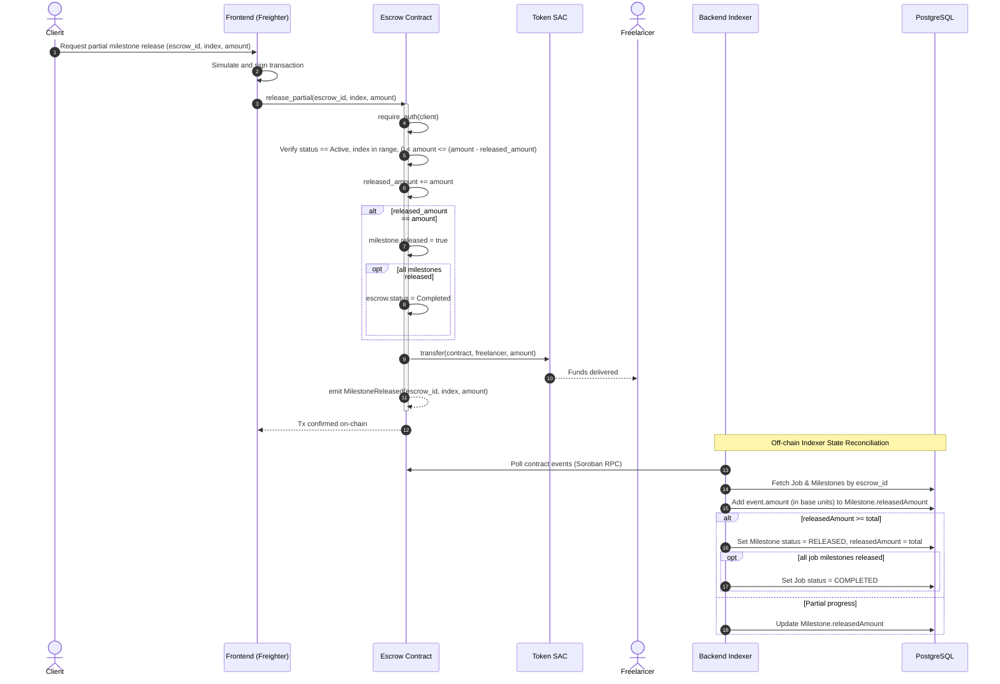
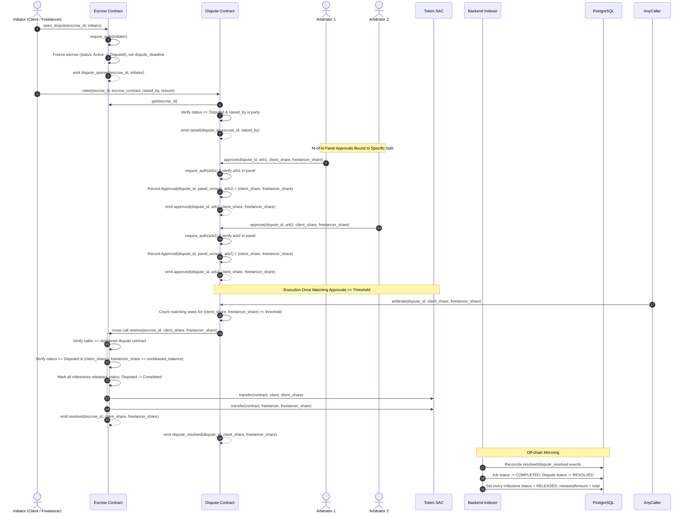

# Architecture

How the three Soroban contracts, the Express API, and the React frontend fit
together, and where the trust boundaries are.

This document is the long-form companion to the
[Architecture section of the README](../README.md#architecture). The contract
source is canonical: if a sentence here disagrees with
`contracts/*/src/lib.rs`, the code is right and this file needs fixing.

## 1. System overview

```
                    signs every transaction
  ┌──────────────┐  ────────────────────────►  ┌──────────────────────────┐
  │   Frontend   │                             │  Stellar testnet         │
  │ React + Vite │  reads state via RPC ─────► │  ┌────────────────────┐  │
  │  Freighter   │                             │  │ escrow contract    │  │
  └──────┬───────┘                             │  │ holds the funds    │  │
         │ HTTPS                               │  └─────────┬──────────┘  │
         ▼                                     │            │ resolve()   │
  ┌──────────────┐   builds unsigned XDR       │  ┌─────────▼──────────┐  │
  │   Backend    │   (never holds a key)       │  │ dispute contract   │  │
  │ Express +    │                             │  │ panel + timelock   │  │
  │ Prisma       │   indexes events            │  └─────────┬──────────┘  │
  │ PostgreSQL   │ ◄────────────────────────── │            │ get()       │
  └──────────────┘                             │  ┌─────────▼──────────┐  │
                                               │  │ reputation contract│  │
                                               │  │ ratings/aggregates │  │
                                               │  └────────────────────┘  │
                                               └──────────────────────────┘
```

There are two independent planes:

- **On-chain (authoritative).** The escrow contract holds the money. The
  dispute contract is the only address allowed to call `escrow.resolve`. The
  reputation contract reads completed escrows but never moves funds.
- **Off-chain (a mirror).** The backend stores job metadata, dispute reasons,
  messages and ratings-for-display in PostgreSQL, and projects contract events
  into those tables. It can be stale, and it is never the authority for whether
  money moved.

## 2. The contracts

### 2.1 `escrow` — funds and the job state machine

The escrow is the only contract that holds value. Its storage is one
`EscrowData` per id:

```rust
pub struct EscrowData {
    pub client: Address,
    pub freelancer: Address,
    pub token: Address,        // SAC address (XLM, USDC, ...)
    pub total_amount: i128,    // sum of milestone amounts, base units
    pub milestones: Vec<Milestone>,
    pub status: EscrowStatus,
    pub created_at: u64,
    pub expiry: u64,           // safety deadline, unix seconds
}
```

A milestone carries `amount`, `released`, `released_amount` and its own
`deadline`. `released_amount` is what makes partial releases safe: a milestone
is only `released` once `released_amount == amount`. The deadline gates
`reclaim_milestone`: once it has passed with the milestone unpaid, the client can
refund that milestone's remainder without waiting for the escrow-level `expiry`.

#### State machine

```
                     fund()                       all milestones released
   ┌─────────┐  ─────────────►  ┌────────┐  ───────────────────────────►  ┌───────────┐
   │ Created │                  │ Active │                                  │ Completed │
   └────┬────┘                  └───┬────┘                                  └───────────┘
        │                           │                                            ▲
        │ update_milestones()       │ open_dispute()                             │
        │ (stays Created)           ▼                                            │ resolve()
        │                       ┌──────────┐                                   │ (dispute
        │                       │ Disputed │ ──────────────────────────────────┘  contract
        │                       └────┬─────┘                                      only)
        │                            │ reclaim_after_dispute_timeout()
        │                            ▼
        │                       ┌──────────┐
        │  reclaim_expired()    │ Refunded │
        └──────────────────────►└──────────┘
              (from Active)
```

| From | To | Caller | Guard | Effect |
|------|----|--------|-------|--------|
| — | `Created` | client | valid milestones (1–20, each > 0), `client != freelancer`, `expiry` in the future | stores the escrow, emits `created` |
| `Created` | `Created` | client | milestone list valid | replaces the breakdown and total, emits `milestones_updated` |
| `Created` | `Active` | client | — | transfers `total_amount` into the contract, emits `funded` |
| `Active` | `Active` / `Completed` | client | milestone not already released, index in range | pays the milestone's outstanding amount, emits `milestone_released`; `Completed` when the last one is fully paid |
| `Active` | `Active` / `Completed` | client | `0 < amount <= remaining on milestone` | pays `amount`, accumulates `released_amount`, emits `milestone_released`; `Completed` when every milestone is fully paid |
| `Active` | `Disputed` | client or freelancer | caller is a party | freezes the escrow, sets `dispute_deadline = now + configured timeout`, emits `dispute_opened` |
| `Active` | `Active` / `Refunded` | client | milestone not released, `milestone.deadline > 0`, `now > milestone.deadline` | refunds that milestone's unreleased remainder, emits `milestone_reclaimed`; `Refunded` once no unreleased milestone is left |
| `Active` | `Refunded` | client | `now > expiry` | refunds every unreleased milestone, emits `refunded` |
| `Disputed` | `Completed` | registered dispute contract only | shares are non-negative and sum exactly to the unreleased balance | marks every milestone released, pays both shares, emits `resolved` |
| `Disputed` | `Refunded` | client | `now > dispute_deadline` | refunds the unreleased balance, emits `refunded` |

`Completed` and `Refunded` are terminal. A late `resolve` after a dispute
timeout refund fails the `status == Disputed` check, so funds cannot be paid
out twice.

Authorization is checked with `Address::require_auth()` inside the contract:
`create`, `update_milestones`, `fund`, both release functions, both reclaim
functions and `open_dispute` require the party named in the call. `resolve`
requires the registered dispute contract's address, not a user.

#### 2.1.1 Partial release (`release_partial`) & `released_amount` tracking

The escrow contract supports incremental milestone funding and releases via `release_partial(escrow_id, milestone_index, amount)` alongside full milestone releases (`release_milestone`).

- **Accounting Invariants:**
  - Every milestone maintains `released_amount <= amount`.
  - The outstanding payable balance on a milestone is `remaining = amount - released_amount`.
  - An invocation must satisfy `0 < amount <= remaining`. Over-releasing or paying zero is rejected (`AmountExceedsMilestone` / `ZeroAmount`).
- **State Transitions:**
  - While `released_amount + amount < milestone.amount`, the milestone stays unreleased (`released = false`) and the escrow stays `Active`.
  - When `released_amount + amount == milestone.amount`, the contract marks the milestone `released = true`.
  - When all milestones in the escrow satisfy `milestone.released == true`, the escrow automatically transitions to `Completed`.
  - The token transfer (`token::Client::transfer`) immediately pays `amount` to the freelancer.
  - The contract publishes `MilestoneReleased { escrow_id, index, amount }`, reporting the delta amount paid in this specific call.



### 2.2 `dispute` — the arbitrator panel

`dispute.init(admin, arbitrators, threshold)` is one-shot and requires the
admin's and every listed arbitrator's signatures, so a fresh deployment cannot
be front-run by an attacker installing themselves. It validates a non-empty,
unique panel and `1 <= threshold <= panel.len()`. The admin can replace the
panel with `set_panel` or change the threshold with `set_threshold`; replacing
the panel invalidates votes from the old panel.

```
raise(escrow_id, escrow_contract, raised_by, reason)
  → verifies escrow.get(escrow_id).status == Disputed
  → verifies raised_by is the escrow's client or freelancer
  → refuses a second dispute for the same (escrow_contract, escrow_id)
  → returns a monotonically increasing dispute id

approve(dispute_id, arbitrator, client_share, freelancer_share)
  → arbitrator must be on the panel and sign
  → stores that arbitrator's vote for that exact split

arbitrate(dispute_id, client_share, freelancer_share)
  → counts panel votes matching the split exactly
  → requires approvals >= threshold
  → cross-calls escrow.resolve(escrow_id, client_share, freelancer_share)
```

Two properties matter:

- **Votes are bound to a split.** Approving "a resolution" in the abstract
  would let anyone call `arbitrate` with arbitrary shares. An arbitrator can
  change their vote by approving again.
- **The escrow still validates the payout.** `escrow.resolve` independently
  checks that the two shares sum to the funds still held, so a buggy or
  compromised dispute contract cannot over- or under-pay.

The configured deadline set by `open_dispute` is the escape hatch: if the panel
never rules, the client can `reclaim_after_dispute_timeout` and recover the
unreleased balance. The escrow admin controls the positive timeout for future
disputes with `set_dispute_timeout` (default: 7 days). See
[`DISPUTES.md`](./DISPUTES.md) for the operational
flow.

#### 2.2.1 Multi-arbitrator threshold voting workflow

Disputes use an M-of-N threshold scheme across an authenticated arbitrator panel:



### 2.3 `reputation` — ratings

`reputation.init(admin, escrow_contract)` records the escrow contract it
trusts. `submit(rater, ratee, escrow_id, score)`:

- requires the rater's signature;
- accepts `1 <= score <= 5`;
- reads `escrow.get(escrow_id)` and requires `status == Completed`;
- requires the rater to be one participant and the ratee to be the other;
- allows one rating per `(rater, escrow_id)`.

The aggregate is amount-weighted: the job's `total_amount` is the weight, and
each escrow counts once per rater, so the same two parties can rate each other on
every job they complete. Because a rating needs a funded, completed escrow and is
weighted by its amount, farming reputation still costs real value, without
pretending to be identity-aware. See [`REPUTATION.md`](./REPUTATION.md).

## 3. How the contracts interact

```
escrow ── resolve() ◄── dispute ── get() ──► escrow
   ▲                       │
   │ get()                 └── (no direct call to reputation)
   │
reputation ── get() ──► escrow
```

- **dispute → escrow**: `raise` calls `escrow.get` to prove the escrow is
  disputed and the raiser is a party; `arbitrate` calls `escrow.resolve` to move
  the money.
- **reputation → escrow**: `submit` calls `escrow.get` to prove the job is
  completed and that the two addresses are its participants.
- **escrow → dispute**: only the registered dispute contract address is
  authorized to call `resolve`; the escrow never calls out to the dispute
  contract itself.
- **No contract calls reputation.** Ratings are pulled by clients, not pushed
  by the escrow.

The shared `interface` crate holds `Milestone`, `EscrowData`, `EscrowStatus`,
`EscrowError` and the generated `EscrowClient`, so the encoding of these types
cannot drift between contracts.

Events are the integration point for everything off-chain. The full catalogue,
including which field is `topic[1]`, is in [`EVENTS.md`](./EVENTS.md).

## 4. The backend's role

**The backend never holds funds or keys.** It has three jobs.

### 4.1 Build unsigned transactions

For every mutating chain action (create, fund, release, reclaim, dispute,
resolve, rate) the API returns an **unsigned XDR** built with the caller's
address as the transaction source. The caller signs it in Freighter and submits
it. The backend cannot sign, so a compromised API cannot move money; the worst
it can do is build a transaction the user declines.

`POST /api/disputes` is a two-step sequence: it returns `escrow.open_dispute`
first, and `POST /api/disputes/:id/raise` returns `dispute.raise`. The order is
enforced on-chain — `dispute.raise` rejects an escrow that is not `Disputed`.

### 4.2 Mirror chain state

The in-process **indexer** polls Soroban RPC for the configured escrow, dispute
and reputation contract ids, decodes each recognised event (name, topic fields
and data map), and applies it to PostgreSQL:

| Event | Effect |
|-------|--------|
| `created` | job → `CREATED` |
| `funded` | job → `ACTIVE` |
| `milestones_updated` | reconciles the job total |
| `milestone_released` | accumulates `Milestone.releasedAmount`; flips to `RELEASED` and completes the job only when every milestone is fully paid |
| `dispute_opened` | job → `DISPUTED`; no `Dispute` row yet |
| `raised` | creates/updates the `Dispute` row with its on-chain id |
| `resolved` / `dispute_resolved` | job → `COMPLETED`, dispute → `RESOLVED`, every milestone released in full (`releasedAmount` = its `amount`, matching `escrow.resolve`) |
| `refunded` | job → `REFUNDED`; closes any open dispute as `REFUNDED` |
| `rated` | upserts the rating and the ratee's aggregate |
| `approved` | recorded; no state change |

The indexer is deliberately conservative:

- the cursor is persisted in `IndexerCursor`, so a restart resumes where it
  stopped;
- events it cannot apply are written to `IndexerDeadLetter` instead of being
  dropped, because the cursor advances regardless;
- Soroban RPC only retains a rolling window (~7 days), so a first run starts
  just behind the tip and an older cursor is clamped;
- `dispute_opened` does **not** create a `Dispute` row. The on-chain dispute has
  no id or reason until `raise`, so a job can be `DISPUTED` with an empty
  `disputes[]` between the two transactions — by design.

#### 4.2.1 Off-chain indexer state reconciliation for partial releases

In `backend/src/indexer.ts` (`handleMilestoneReleased`), reconciling `milestone_released` events requires careful decimal handling and accumulation:

1. **Delta Event Amount:**
   `milestone_released` carries `amount` representing the amount paid in *this single transaction*, not the milestone's aggregate. A full release after earlier partial releases emits only the *remainder*.
2. **Exact Base-Unit Arithmetic:**
   Event amounts arrive as `i128` integer base units (e.g., stroops with 7 decimal places for XLM/USDC). In the PostgreSQL database, milestone amounts are stored as decimal strings in human units (e.g. `"100.5"`). To prevent precision loss and floating-point rounding errors:
   - Milestone `amount` and existing `releasedAmount` are converted to integer base units with `toBaseUnits(..., decimals)`.
   - The event's delta `amount` (`BigInt`) is added: `releasedSoFar = existingReleasedBaseUnits + eventAmount`.
3. **Milestone Completion & Clamping:**
   - If `releasedSoFar >= milestoneTotalBaseUnits`, the milestone is fully paid: status is updated to `RELEASED`, `releasedAt` is stamped, and `releasedAmount` is clamped to the milestone total (`formatAmount(milestoneTotal, decimals)`). Clamping ensures that any stray or duplicate event cannot push the stored amount past the total.
   - Otherwise, the milestone status remains unchanged (e.g. `PENDING`), and `releasedAmount` is updated with `formatAmount(releasedSoFar, decimals)`.
4. **Job Completion Invariant:**
   - When a milestone flips to `RELEASED`, the indexer checks whether all milestones belonging to the job are now `RELEASED`.
   - Only when every milestone is released does the job transition to `COMPLETED`.

### 4.3 Serve metadata and projections

PostgreSQL holds what the chain does not: job titles and descriptions, skill
tags, milestone descriptions, dispute reasons (the `raised` event carries none),
messages, bookmarks, reminders and notification preferences. It also stores
every recognised event in `ChainEvent` so a receipt or a transaction history can
link to the transaction hash, which the state tables do not keep.

The API is intentionally read-mostly:

- public reads for jobs, profiles, reputation, receipts and transaction
  histories;
- authenticated writes for metadata changes, bookmarks, messages and
  notification preferences;
- every chain write returns unsigned XDR, as above.

Wallet authentication is SEP-53: the client signs a single-use nonce, the
backend verifies it and issues a JWT. Nonces are persisted so a replay fails.

### 4.4 Failure and trust boundaries

| Failure | Consequence | Mitigation |
|---------|-------------|------------|
| Backend is down | UI cannot read metadata or build transactions | Contracts and already-signed transactions are unaffected; the frontend can encode calls itself for the core escrow actions |
| Indexer lags | UI shows stale status | Cursor resumes; `POST /api/disputes/:id/sync` records a dispute id immediately; reads can be refreshed |
| Indexer cannot decode an event | State would drift | the event goes to `IndexerDeadLetter` and the run logs it |
| RPC loses old history | Events older than the window are unrecoverable | the cursor is clamped with a warning; do not leave the indexer down for more than a week |
| Backend is compromised | It can lie in its projections, read its own database and build transactions | it still cannot sign, hold funds, or move money; the chain remains authoritative |
| Dispute panel stalls | Funds stay frozen | client's configured `reclaim_after_dispute_timeout` |

## 5. Deployment shape

| Piece | Where | Why |
|-------|-------|-----|
| Contracts | Stellar testnet | only supported network; unaudited |
| Frontend | static host (Vercel) | Vite build; `vercel.json` carries the SPA rewrite |
| Backend | long-running host (Render) | the indexer polls in-process, so serverless is not an option |
| Database | PostgreSQL | Prisma migrations run on container start |

Contract ids change on every deploy. `scripts/deploy_testnet.sh` writes the new
ids to the frontend and backend environment files, and the backend warns at
startup when its configured ids no longer match `deployments/testnet.json`.

## 6. Related documents

- [`EVENTS.md`](./EVENTS.md) — every event, its topic and its fields
- [`DISPUTES.md`](./DISPUTES.md) — panel flow, thresholds, timelock
- [`REPUTATION.md`](./REPUTATION.md) — rating rules and weighting
- [`ASSETS.md`](./ASSETS.md) — the payment-asset registry
- [`TESTNET.md`](./TESTNET.md) — live ids and reproduction steps
- [`DEPLOYMENT.md`](./DEPLOYMENT.md) — deploy checklist
- [`../CONTRIBUTING.md`](../CONTRIBUTING.md) — setup and conventions
